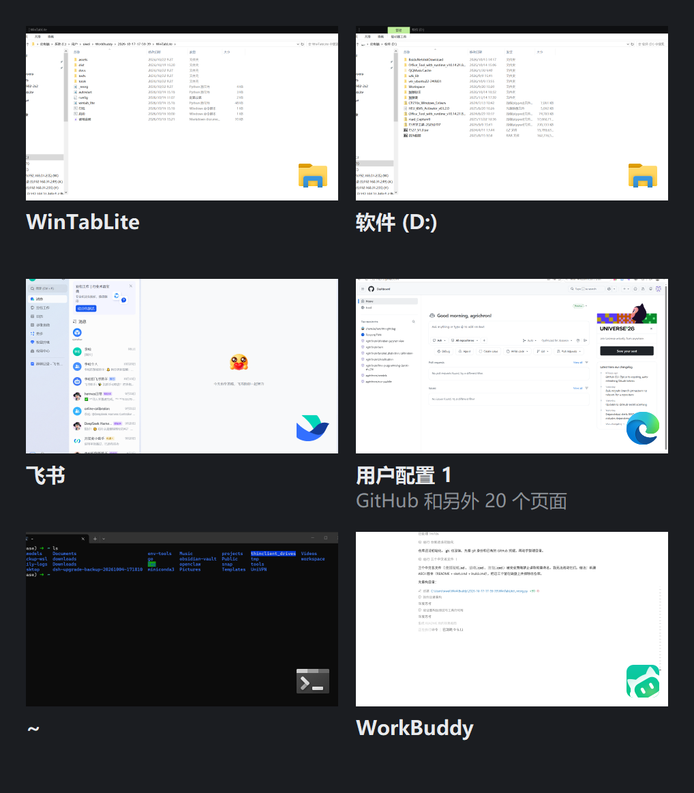

# WinTab Lite

贴在屏幕左边缘的窗口缩略图抽屉。按 `Alt + Tab`（或 `Alt + \`` 、或鼠标撞左边缘）滑出，看清每个窗口里是什么，点一下就切过去。



<sub>预览图做过脱敏：窗口标题替换为示例文本，缩略图内容打了灰度马赛克。</sub>

## 为什么写这个

- **Win + Tab** 铺满整个屏幕，遮挡一切，而且切换后还要再等它收起；
- **Alt + Tab** 只给标题和图标，5 个 VS Code 窗口长得一模一样，靠猜；
- 任务栏预览要一个个悬停，多个窗口时很难比对。

WinTab Lite 只用屏幕左侧一条，显示**真实缩略图**，并且**全程不抢焦点**——你正在编辑器里打的字、输入法状态、光标位置都不会被打断。

## 特性

- **真实缩略图**：基于 DWM `DwmRegisterThumbnail`，是窗口的实时画面，不是截图缓存。
- **不抢焦点**：面板用 `WS_EX_NOACTIVATE`，唤出/浏览/收起全程不激活，当前输入不受影响。
- **按应用分组**：同应用的窗口连成一组，组按 exe 文件名排序，组内按标题字母序（中文走系统 locale 的拼音规则）。
- **一眼分清**：右下角叠加应用图标（透明底），悬停时右上角出现关闭按钮。
- **三种唤出方式**：`Alt + Tab` 接管（可关）、`Alt + \`` 热键、鼠标撞左边缘。
- **多屏 / 高 DPI 自适应**：按鼠标所在屏幕的工作区反推尺寸，跨屏不会被系统按 DPI 缩放（拦截了 `WM_DPICHANGED`）。
- **托盘常驻**，右键可开关开机自启。

## 快速开始

**直接运行**：从 [Releases](https://github.com/agrichron/WinTabLite/releases/latest) 下载 `WinTabLite-v1.0.0-win64.zip`，解压后双击 `WinTabLite.exe`（单文件，无需 Python）。压缩包里已带 `config.ini`，两者必须放同一目录；删掉 config.ini 则用内置默认值。

**从源码运行**：

```bat
pip install -r requirements.txt
start.cmd
```

启动后没有窗口，只有托盘区一个蓝色图标。退出：托盘右键 → 退出。

## 操作

| 操作 | 效果 |
|---|---|
| `Alt + Tab` | 取代系统任务切换器，打开面板（可在配置里关掉） |
| `Alt + \`` | 主热键，开关面板 |
| 鼠标撞屏幕左边缘 | 停顿约 0.3 秒滑出 |
| 点击缩略图 | 切到该窗口，面板收起 |
| 悬停后点右上角 ✕ | 关闭该窗口（发 `WM_CLOSE`，保存提示会正常弹出） |
| 面板外点击一下 | 收起 |
| 滚轮 | 滚动 |

## 配置

同目录 `config.ini`，改完重启生效。

| 键 | 取值 | 说明 |
|---|---|---|
| `sort` | `app_group` / `zorder` | 按应用分组 / 纯 Z 序 |
| `scale` | `auto` / `0.6`~`3.0` | 自动按屏幕算尺寸 / 固定倍数 |
| `thumb` | `standard` / `compact` | 缩略图档位 |
| `fit` | `cover` / `contain` | 裁切填满 / 完整留边 |
| `show_logo` | `true` / `false` | 右下角应用图标 |
| `logo_bg` | `white` / `none` / `dark` | 图标底色 |
| `hotkey` | `true` / `false` | `Alt + \`` 热键 |
| `intercept_alt_tab` | `true` / `false` | 接管系统 `Alt+Tab` |
| `max_width_ratio` | `0.2`~`0.9` | 面板宽度上限（占工作区比例） |
| `max_height_ratio` | `0.3`~`1.0` | 面板高度上限 |

完整说明见 [docs/usage.zh-CN.md](docs/usage.zh-CN.md)。

## 目录结构

```
wintab_lite.py        主程序（单文件，约 1000 行）
autostart.py          开机自启的快捷方式读写
config.ini            用户配置
start.cmd             源码方式启动
build.cmd             PyInstaller 打包
assets/               图标
docs/                 文档与预览图
tests/                手工验证脚本（会真实操作鼠标/窗口，非单元测试）
tools/                图标生成、自启修复等辅助脚本
```

## 打包

```bat
build.cmd
```

产物在 `dist\WinTabLite.exe`（onefile，约 60MB）。图标由 `tools/make_icon.py` 生成。

## 已知限制

- **不支持键盘操作**：方向键、Esc 都不可用，这是"不抢焦点"的代价。
- **不收录其他虚拟桌面上的窗口**：DWM 缩略图取不到。
- 少数挂起的 UWP 窗口可能显示为空白格。
- 关机自启依赖 Python 环境（源码方式）或 exe 路径稳定（打包方式），移动目录后需重设。

## 许可

MIT，见 [LICENSE](LICENSE)。
